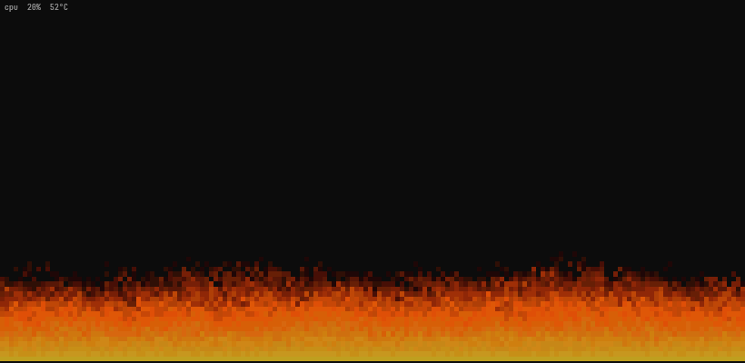

# brazier

A fire in your terminal that burns on your CPU.



Every core gets its own patch of the fire and the flames grow with its load.
An idle machine just smoulders, a compile makes it roar. The color follows
the CPU temperature, so a cold chip burns orange and a hot one goes white.

The effect itself is the fire from the PlayStation port of Doom, only fed
from `/proc/stat` instead of a constant.

## Install

```
cargo install --git https://github.com/Frad70/brazier
```

## Usage

```
brazier [--total] [--fps N] [--info]
```

`--total` burns one fire for the whole CPU instead of one per core,
`--fps` sets the frame rate (30 by default) and `--info` starts with the
load and temperature shown in the corner. In the fire, `i` toggles that
readout and `q` or Esc quits.

Linux only. The temperature is read from the first sensor found among
k10temp, zenpower, coretemp, cpu_thermal and acpitz. If none of them is there,
the fire still works, just in a fixed color.

You want a terminal with truecolor. Cold pixels are left on the terminal's
own background, so it looks right on transparent terminals too.

## Credits

Fabien Sanglard's [How DOOM fire was done](https://fabiensanglard.net/doom_fire_psx/),
where the algorithm and the palette come from.

## License

MIT
