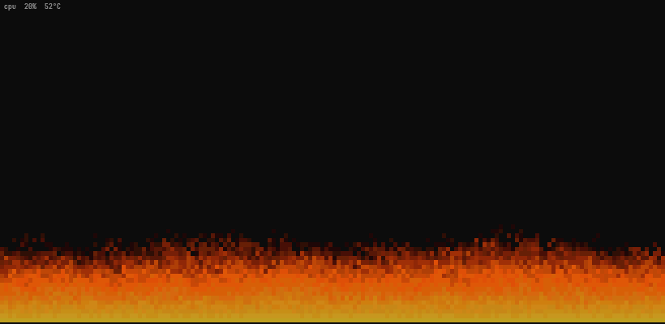

<div align="center">




[Read in English](README.md)

</div>

У каждого ядра свой кусок пламени, и он растёт вместе с нагрузкой. Машина
без дела едва тлеет, а сборка раздувает пожар. Цвет зависит от температуры
процессора: холодный горит янтарным, горячий раскаляется добела.

## Установка

Это один статический бинарник, собирать ничего не нужно:

```sh
curl -fsSL https://github.com/Frad70/brazier/releases/latest/download/brazier-$(uname -m)-linux.tar.gz \
  | sudo tar -xz --no-same-owner -C /usr/local/bin brazier
```

Сборки есть для x86_64, aarch64 и armv7, работают на любом дистрибутиве.
Чтобы удалить, сотрите `/usr/local/bin/brazier`. Без root распакуйте в
`~/.local/bin` и проверьте, что эта папка есть в `PATH`.

Если стоит Rust, можно собрать из исходников:

```sh
cargo install --git https://github.com/Frad70/brazier
```

## Запуск

```
brazier [--total] [--fps N] [--info]
```

| Флаг | Что делает |
|---|---|
| `--total` | один огонь на весь процессор вместо отдельного на каждое ядро |
| `--fps N` | частота кадров от 1 до 120, по умолчанию 30 |
| `--info` | сразу показать нагрузку и температуру в углу |

Пока горит, `i` прячет и показывает эту строку, а `q`, Esc или Ctrl-C
тушат огонь.

Куда его можно поставить:

- в узкую панель tmux рядом с долгой сборкой, чтобы видеть, что она идёт
- на свободный монитор домашнего сервера
- на ноутбук с `--total --fps 15`, так он меньше тратит батарею

## Как это работает

Это огонь из PlayStation-версии Doom. Нижний ряд всё время раскалён, а каждый
кадр любой пиксель перенимает жар соседа снизу, чуть остывший и сдвинутый
в сторону на случайный шаг. Вот и весь трюк, и это уже похоже на огонь.

brazier меняет только то, как быстро гаснет жар. Каждый столбец остывает
со скоростью, которую задаёт нагрузка его ядра, поэтому пламя занятого ядра
поднимается почти до верха, а у простаивающего остаётся в несколько рядов.
Температура задаёт, насколько горяч нижний ряд, поэтому холодный процессор
до белого не доходит.

Нагрузка берётся из `/proc/stat`, температура из hwmon.

## Что нужно

Linux и терминал с truecolor. Остывшие пиксели не закрашиваются, поэтому
прозрачный терминал остаётся прозрачным.

Для температуры brazier берёт первый датчик, который найдёт, в таком
порядке: k10temp, zenpower, coretemp, cpu_thermal, acpitz. Если нет ни
одного, огонь всё равно горит, только одним цветом.

## Благодарности

Алгоритм и палитра взяты из статьи Fabien Sanglard
[How DOOM fire was done](https://fabiensanglard.net/doom_fire_psx/).

## Лицензия

MIT
